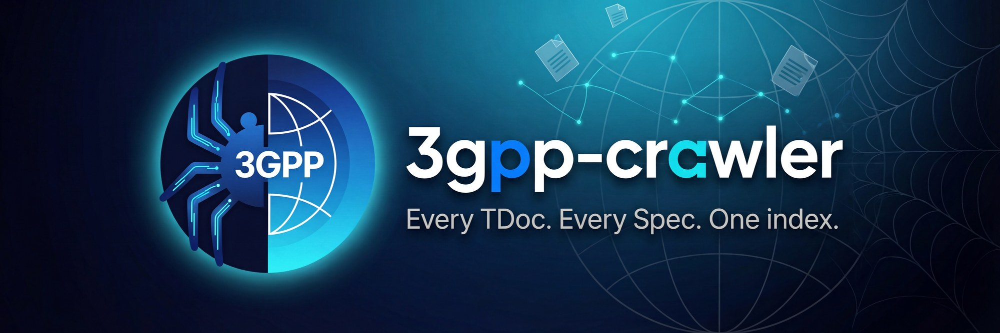

# 3GPP Crawler



[](https://pypi.org/project/3gpp-crawler/)
[](https://pypi.org/project/3gpp-crawler/)
[](https://jr2804.github.io/3gpp-crawler/)
[](LICENSE)

A command-line tool for crawling the 3GPP FTP server, caching 3GPP document metadata in a local database, and querying structured data via JSON/YAML output.

**Github repository**: <https://github.com/jr2804/3gpp-crawler>

## Features

- **Official sources, no account needed**: meeting and TDoc metadata come from the 3GPP FTP server and portal — basic crawling and querying work without EOL credentials
- **Spec Catalog**: Crawl and query normalized 3GPP Technical Specifications (TS/TR); the official 3GPP source is tried first, WhatTheSpec serves as optional convenience/fallback
- **Local SQLite Database**: Store TDoc and Spec metadata for fast querying
- **Persistent HTTP Caching**: 50-90% faster incremental crawls with automatic request caching
- **Case-Insensitive Queries**: Search for TDocs regardless of case
- **Multiple Output Formats**: Export results as table, JSON, or YAML
- **Incremental Updates**: Only fetch new data on subsequent crawls
- **Archive Listings**: Inspect the files inside TDoc/spec zip archives (`tdoc files`, `spec files`) without a full download
- **Rich CLI**: Beautiful terminal output with progress indicators
- **Tag System**: Organize TDocs and specs with lightweight tags (no workspace needed)
- **MCP Server**: Run as stdio MCP server for AI agent integrations (`3gpp-crawler mcp`)

## Installation

Requires Python 3.13 or 3.14.

### From PyPI (recommended)

```bash
uv tool install 3gpp-crawler
3gpp-crawler --help
```

Equivalent alternatives:

```bash
pipx install 3gpp-crawler      # pipx
pip install 3gpp-crawler       # pip
uvx 3gpp-crawler --help        # run ad hoc, without installing
```

### From source (development)

```bash
git clone https://github.com/jr2804/3gpp-crawler.git
cd 3gpp-crawler
uv sync
uv run 3gpp-crawler --help
```

## Configuration

### Environment Variables

Configure the application using a `.env` file:

```bash
# Copy the example file
cp .env.example .env

# Edit .env and add your settings:

# ETSI Online (EOL) credentials (optional - authenticated portal access)
# Single/missing TDocs come from the official 3GPP portal by default;
# WhatTheSpec is only a third-party convenience/fallback. Credentials give
# you official (authenticated) endpoints and full metadata.
TDC_EOL_USERNAME=your_username
TDC_EOL_PASSWORD=your_password

# HTTP Cache Configuration (optional - uses defaults if not set)
HTTP_CACHE_TTL=7200                      # Cache TTL in seconds (default: 7200 = 2 hours)
```

Alternatively, you can:

```bash
# Pass credentials via CLI options:
uvx tdoc-crawler crawl-meetings --eol-username your_username --eol-password your_password

# Or set environment variables directly:
export TDC_EOL_USERNAME=your_username
export TDC_EOL_PASSWORD=your_password
export HTTP_CACHE_TTL=3600
```

NOTE:    Credentials are optional — crawling and querying work against official unauthenticated sources without them. If provided, they are resolved in this order: CLI options > config file > environment variables. To be prompted interactively for missing credentials, set `TDC_EOL_PROMPT=true` (or `credentials.prompt` in the config file).

## Quick Start

### 1. Command Reference

`3gpp-crawler` is the main CLI; `tdoc-crawler` and `spec-crawler` are shortcuts for the `tdoc` and `spec` groups.

| Command | Shortcut | Purpose |
|---------|----------|---------|
| **3gpp-crawler** | | |
| `tdoc {subcommand}` | `tdoc-crawler` | TDocs and meetings (see below) |
| `spec {subcommand}` | `spec-crawler` | Technical specifications (see below) |
| `config {init,show,validate,docs}` | | Manage configuration |
| `tag {add,remove,list}` | | Manage lightweight tags on TDocs and specs |
| `database {clear-tdocs,clear-specs,clear-meetings,clear-all,export-tags,import-tags}` | `db` | Database maintenance: selective/all clears, tag backup & restore |
| `mcp` | | Run as MCP server for AI agents |
| `version` | | Show installed version |
| **tdoc group** | | |
| `tdoc crawl-meetings` | `cm` | Populate meeting database (Run this first!) |
| `tdoc crawl` | `ct` | Crawl TDoc metadata from FTP |
| `tdoc query` | `qt` | Search for TDocs (auto-fetches if missing) |
| `tdoc query-meetings` | `qm` | Search and display meeting metadata |
| `tdoc open` | | Download and open a TDoc |
| `tdoc checkout` | | Batch download TDocs |
| `tdoc files` | | List the files inside a TDoc's zip archive |
| `tdoc stats` | | View database statistics |
| **spec group** | | |
| `spec crawl` | | Crawl technical specification metadata |
| `spec query` | | Search technical specifications |
| `spec open` | | Download and open latest spec document |
| `spec checkout` | | Batch download specifications |
| `spec files` | | List the files inside a spec's zip archive |

### 2. Crawl Metadata

Gather metadata from the official 3GPP sources:

```bash
# Populate meeting database (REQUIRED first step)
tdoc-crawler crawl-meetings

# Crawl TDoc metadata (RAN, SA, CT)
tdoc-crawler crawl

# Populate spec catalog
spec-crawler crawl
```

### 3. Query Metadata

Search and filter stored information:

```bash
# Query a specific TDoc (auto-fetches metadata if missing)
tdoc-crawler query R1-2400001

# Query specifications
spec-crawler query 23.501

# List recent meetings
tdoc-crawler query-meetings --limit 10
```

### 4. Utilities & File Access

Open documents, batch download (checkout), and check database status:

```bash
# Download and open a TDoc with system default app
tdoc-crawler open R1-2400001

# Download and open latest version of a spec
spec-crawler open 23.501

# Batch download (checkout) TDocs to local folder
tdoc-crawler checkout R1-2400001 S2-2400567

# Batch checkout specifications
spec-crawler checkout 26130-26140

# List the files inside a TDoc/spec archive
tdoc-crawler files R1-2400001
spec-crawler files 26.130

# View database statistics
tdoc-crawler stats
```

## Model Context Protocol (MCP)

Expose the crawler to AI agents via the stdio MCP server:

```json
{
  "mcpServers": {
    "3gpp-crawler": {
      "command": "uvx",
      "args": ["3gpp-crawler", "mcp"]
    }
  }
}
```

## Documentation

For detailed documentation, including command deep-dives, configuration, and architecture, see the [Documentation Index](https://jr2804.github.io/3gpp-crawler/) or [docs/index.md](docs/index.md).

## Outlook

Future enhancements may include:

- Improved RAG with PageIndex, see: <https://github.com/VectifyAI/PageIndex.git>, <https://github.com/VectifyAI/pageindex-mcp>
- Web-based UI for interactive querying and document exploration

## Development

For information on setting up the development environment, running tests, and code quality standards, please refer to the [Development Guide](docs/development.md).

## License

This project is licensed under the [MIT License](LICENSE).

______________________________________________________________________

Repository initiated with [fpgmaas/cookiecutter-uv](https://github.com/fpgmaas/cookiecutter-uv).
