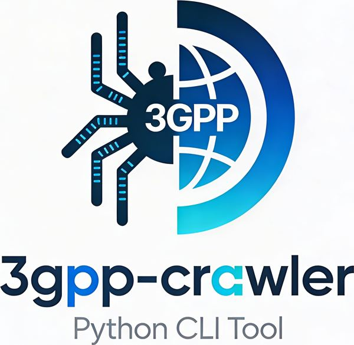

# 3GPP Crawler



A command-line tool for crawling the 3GPP FTP server, caching 3GPP document
metadata in a local database, and querying structured data via JSON/YAML
output.

`3gpp-crawler` is the main CLI; `tdoc-crawler` and `spec-crawler` are
shortcuts for the `tdoc` and `spec` groups.

## Quick Start

```bash
# 1. Populate meeting database (REQUIRED first step)
3gpp-crawler tdoc crawl-meetings

# 2. Crawl TDoc metadata
3gpp-crawler tdoc crawl

# 3. Crawl spec metadata
3gpp-crawler spec crawl

# 4. Query
3gpp-crawler tdoc query --working-group SA --start-date 2024
```

## Documentation

### Guides

- [**Crawling**](crawl.md) — Fetch metadata from 3GPP servers and portal.
- [**Querying**](query.md) — Search and display stored metadata.
- [**Tags**](tags.md) — Organize TDocs and specs with lightweight tags.
- [**Utilities**](utils.md) — Open, checkout, and stats commands.
- [**WhatTheSpec**](whatthespec.md) — The primary metadata source.
- [**MCP Server**](mcp.md) — Use 3gpp-crawler from AI agents.
- [**Configuration**](config.md) — Config files, environment variables.
- [**HTTP Caching & Misc**](misc.md) — Caching behavior, credentials.
- [**Convert-LO Usage**](convert-lo-usage.md) — LibreOffice conversion package.

### Development

- [**Development Guide**](development.md) — Setup, testing, architecture.
- [**Contributing**](contributing.md) — How to contribute.
- [**Code of Conduct**](code_of_conduct.md) — Community standards.

### Reference

- [**API Reference**](reference/api.md) — Python API documentation.
- [**Credits**](credits.md) — Acknowledgments.
- [**License**](license.md) — License information.
